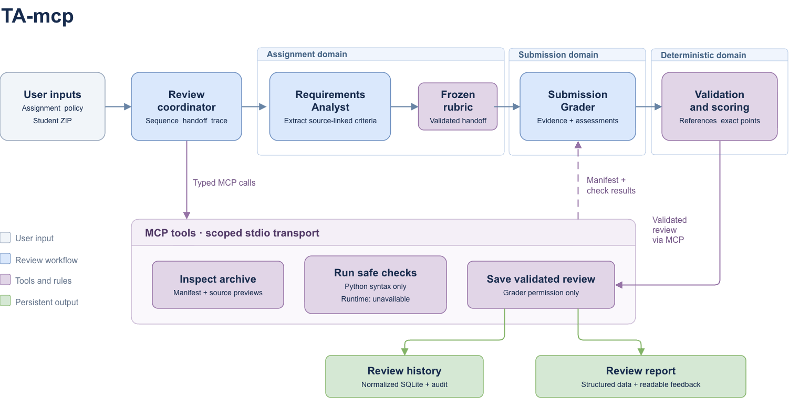
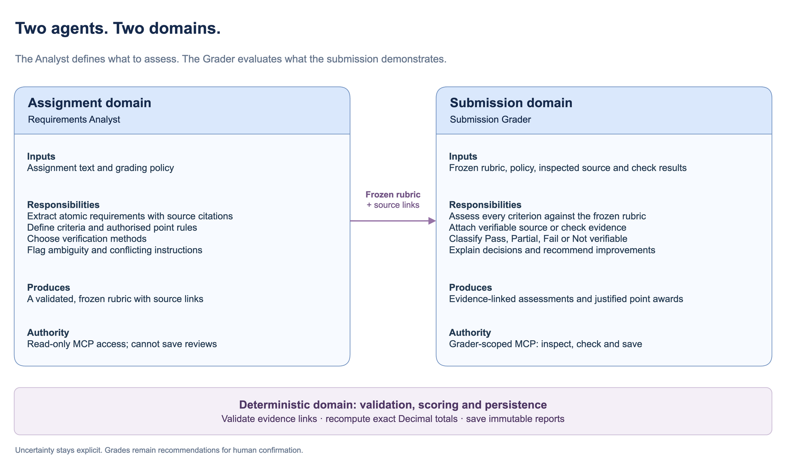

# TA-mcp

TA-mcp reviews a local lab submission against an assignment and a grading policy. Two specialised LLM agents interpret the assignment and assess the submission. A deterministic Python core validates their outputs, computes exact scores, and saves an evidence-backed report for human confirmation.

The system is independent of any particular course, assignment, or student. It provides a CLI, a local MCP server, and a SQLite audit database.

## Architecture



[Open the editable draw.io diagram](docs/diagrams/architecture.drawio). It contains both the system architecture and the agent responsibilities view.

The review coordinator controls execution order, passes validated data between the agents, records local trace events, and calls tools through an actual stdio MCP client. The CLI starts the scoped MCP subprocesses automatically.

The architecture separates three domains:

| Domain | Responsibility | Boundary |
| --- | --- | --- |
| Assignment domain | Interpret assignment text and grading policy; extract cited requirements; define criteria, verification methods, and authorised point rules. | Produces a frozen rubric. Cannot persist reviews. |
| Submission domain | Assess each frozen criterion using inspected source and actual check results; attach evidence, explain uncertainty, and recommend improvements. | Uses the existing rubric. The grader workflow alone has permission to request a final save. |
| Deterministic domain | Validate citations and entity relationships, verify tool provenance, calculate Decimal scores, and persist immutable review records and reports. | Recomputes totals and rejects inconsistent model outputs before saving. |

### Agent responsibilities



The **Requirements Analyst** receives the assignment and policy. It extracts atomic requirements with exact source citations, creates the rubric, and identifies ambiguity or conflicting instructions. Point allocations and penalties must come from the supplied assignment. Its MCP scope is read-only.

The **Submission Grader** receives the frozen rubric, policy, inspected source, and actual check results. It produces one assessment per criterion, with evidence, justified point awards when authorised, and feedback. Its workflow can inspect the archive, request safe checks, and save the final validated review through MCP.

The agents exchange a structured rubric with stable identifiers and source references. The shared core checks these references and computes the numeric recommendation; the LLM does not supply a trusted final total.

### Review flow

1. Read the assignment and policy, then inspect the ZIP without extracting or executing it.
1. Run the Requirements Analyst and validate its source-linked rubric.
1. Freeze the rubric and policy, inspect the submission again, and collect available check results through MCP.
1. Run the Submission Grader against the frozen criteria and observed evidence.
1. Validate the complete review and compute exact scores and uncertainty bounds.
1. Save the reports and normalized audit records through the grader-only persistence tool.

### MCP tools

| Tool | Purpose | Access |
| --- | --- | --- |
| `inspect_archive` | Return archive metadata, the file manifest, detected languages/build systems, and bounded UTF-8 source previews. | Analyst and grader scopes; read-only. |
| `run_checks` | Freeze review inputs and return actual safe check results or explicit nonexecution reasons. | Grader scope; read-only. |
| `save_review` | Verify the bundle against trusted observations, then persist SQLite records and deterministic JSON/Markdown reports. | Grader scope; the only persistent-state tool. |

Server registration and client allowlists enforce these permissions. Archive and output locations are fixed by the user-authorized session. Model outputs cannot select arbitrary commands or report destinations.

## Setup

Requirements:

- Python 3.14.
- `uv` for dependency and environment management.
- An OpenAI API key for live reviews.

From the repository root, install the locked dependencies:

```bash
uv sync --locked --no-editable
```

Set the API key in the shell used to run the CLI:

```bash
export OPENAI_API_KEY="your-api-key"
```

The examples use `--no-editable` to avoid a macOS hidden `.pth` file issue observed in this workspace. The SQLite schema is migrated automatically on the first save; no separate database server is required.

## Run a review

Provide a local ZIP, a UTF-8 Markdown or plain-text assignment, and a JSON or YAML policy:

```bash
uv run --no-editable ta-mcp \
  --submission student.zip \
  --requirements assignment.md \
  --policy examples/policy.yaml \
  --output reviews \
  --database reviews.sqlite
```

The [example assignment](examples/assignment.md) and [example policy](examples/policy.yaml) show the accepted inputs. Replace the submission and assignment paths with your own files.

Use `--model` or `TA_MCP_MODEL` to select the model identifier. The default is `gpt-4.1-mini`.

Use `--base-url` or `OPENAI_BASE_URL` to connect to any OpenAI-compatible API (e.g. Ollama, vLLM, OpenRouter, Groq, LM Studio):

```bash
uv run --no-editable ta-mcp \
  --submission student.zip \
  --requirements assignment.md \
  --policy examples/policy.yaml \
  --model meta-llama/llama-3.3-70b-instruct \
  --base-url http://localhost:11434/v1
```

### Workflow selection

Select between the two supported workflow architectures using `--workflow`:

- `--workflow two-agents` (default): Two specialized agents with a frozen rubric handoff (Requirements Analyst extracts criteria; Submission Grader evaluates evidence and checks).
- `--workflow simplified`: A single agent baseline that receives policy, requirements, and all submission code into its context, grades it, and produces the same structured grading report.

```bash
uv run --no-editable ta-mcp \
  --submission student.zip \
  --requirements assignment.md \
  --policy examples/policy.yaml \
  --workflow simplified
```

Alternative entrypoints accept the same arguments:

```bash
uv run --no-editable python main.py --help
uv run --no-editable python -m ta_mcp --help
```

Each LLM step has a 120-second timeout. MCP calls have a 30-second timeout. Invalid inputs produce a readable CLI error and a nonzero exit status.

### Grading policy

An empty policy `{}` uses the defaults. The policy controls analysis strictness, code style, feedback detail, and which checks are requested. Decimal settings such as `max_score` must be integers or quoted decimal strings.

Strictness changes analysis depth. It does not change source-defined weights or penalties. A policy maximum alone does not authorise inventing a numeric allocation. When the assignment has no coherent point allocation, the review remains `UNSCORED`.

## Reports and scoring

A successful save creates a directory under the selected output path:

```text
reviews/<run-id>/
  review.json
  review.md
  COMPLETED
```

- `review.json` contains versioned entity collections, ID references, provenance hashes, the policy, rubric, checks, typed evidence, assessments, computed score components, and trace events.
- `review.md` presents the same validated decisions as a readable report.
- `COMPLETED` marks successful finalization and contains the canonical JSON digest.

Each criterion is `PASS`, `PARTIAL`, `FAIL`, or `NOT_VERIFIABLE`. Verifiable decisions require evidence. Unavailable checks cannot establish that a submission is incorrect.

Scores use Decimal arithmetic. Core points, bonus points, and explicit penalties remain distinct. Unverified point-bearing criteria produce possible score bounds and a null final recommendation. All grades remain recommendations for human confirmation.

The SQLite database stores normalized audit records with foreign keys, uniqueness checks, immutable rubric/policy snapshots, and migration management. Repeating the same save is idempotent; conflicting content for an existing review identity is rejected. Finalization is recoverable across the database and filesystem. Only a matching completion marker and finalized records indicate a successful save.

See [the data model](docs/data-model.md) for the schema, scoring equations, and finalization details.

## Security and current limitations

ZIP inspection runs in memory and enforces size, file-count, and expansion limits. It rejects traversal paths, links, special files, duplicate members, encryption, and corrupt archives. The original submission stays unchanged. Student content is treated as untrusted data.

The included Python syntax check uses `ast.parse` on bounded source data. It does not import or execute student code. Compilation, student tests, and memory checks return `UNAVAILABLE` because the MVP has no isolated execution backend. A syntax pass does not prove runtime correctness, and missing tests do not automatically fail a criterion.

Live reviews send the assignment and bounded student source previews to the configured OpenAI model. MCP subprocesses do not receive API keys. OpenAI SDK telemetry tracing is disabled; bounded local audit metadata is saved with the review.

The MVP excludes a web UI, LMS integrations, student/course accounts, cloud infrastructure, and a single-agent baseline comparison.

## Development and verification

Run relevant checks from the repository root:

```bash
uv run --no-editable isort --check-only .
uv run --no-editable black --check .
uv run --no-editable flake8 src/ scripts/ tests/ app/
uv run --no-editable ty check
uv run --no-editable pytest
uv run --no-editable pre-commit run --all-files
```

Regenerate the versioned JSON Schemas with:

```bash
uv run --no-editable python scripts/export_schemas.py
```

The tests replace only the external LLM boundary with deterministic responses. Archive inspection, MCP subprocess transport, validation, scoring, migrations, SQLite persistence, and report saving are real. Five grading scenarios cover valid source, syntax failure, a missing required file, unavailable runtime verification, and qualitative scoring. These tests do not require an API key; testing live LLM behaviour does.
