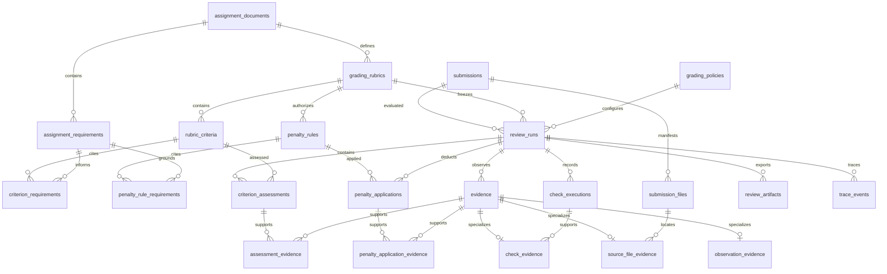

# Data contracts and persistence

All external DTOs use Pydantic v2, `extra="forbid"`, and `schema_version="1.0"`. Independent entities have UUID primary keys. Submission and file identifiers are deterministic UUIDv5 values derived from archive content identity and canonical paths; other IDs use UUIDv4. Timestamps are timezone-aware UTC. Points use finite nonnegative Decimal values, up to 16 digits and four decimal places. Binary floats are rejected at grading boundaries.

The authoritative portable representation is `ReviewBundle`. It stores separate collections and references for requirements, criteria, source bindings, files, check executions, typed evidence, assessments, penalties, and traces. JSON object keys and collection ordering are canonicalized. Decimal strings have no insignificant trailing zeros. Frozen model objects are revalidated at persistence boundaries; mutable Python collections cannot bypass saving validation. JSON Schemas are in `schemas/1.0/` and regenerated with `uv run python scripts/export_schemas.py`.

## Relational structure

There are 22 domain tables plus Alembic's revision table. The initial migration is packaged at `src/ta_mcp/migrations/versions/0001_initial.py` and runs on the first save. Startup, inspection, and check collection do not create the database. This first revision builds the initial metadata; future schema changes must introduce explicit new revisions rather than modifying its historical definition.

Each entity UUID determines only that entity's scalar attributes. Source spans are flattened into inclusive line columns. Many-to-many relationships have composite primary keys: criterion/requirement, penalty-rule/requirement, assessment/evidence, and penalty-application/evidence. Their pair of identifiers determines membership without repeated source text or grading definitions. Evidence has one common identity row and exactly one typed detail row, enforced by validation and transactional insertion.

The schema is in 1NF because authoritative attributes are scalar and associations are rows. It is in 2NF because independent entity attributes depend on their entire UUID key and association tables contain only their complete relationship keys. It is in 3NF because assignment text, rubric weights, policy settings, tool results, evidence details, and assessment decisions remain in their respective entities. No review, rubric, or evidence collection is hidden in a JSON column. Summaries are derived on load. The run's content digest and finalization flag are operational metadata, rather than an alternative authoritative review representation.

Foreign keys use SQLite's default restrictive referential action and are enabled on every connection. Natural uniqueness includes assignment/code, assignment/rubric-version, rubric/code, rubric/ordinal, submission/path, run/criterion, run/penalty-rule, run/artifact-format, and run/trace-sequence. Checks constrain nonnegative quantities, source ranges, and enum states. Service validation checks cross-assignment and cross-run relationships, complete assessments, sourced allocations, and exactly one evidence subtype. SQL triggers prevent changes/deletions of immutable rows; repository validation also rejects changed child/association sets under frozen roots. Explicit replacements need new identities and versions.

SQLite NUMERIC storage can pass through binary floating point. To preserve exact arithmetic, `ExactPoints` stores Decimal amounts as scaled integers in ten-thousandths, with SQL nonnegative checks and DTO precision bounds. UTC timestamps are restored by a typed SQLAlchemy adapter. No denormalized score total is stored.

## Validation and scoring

Each assignment requirement cites an exact sequence of original lines. Every criterion has source bindings within the same assignment. Numeric allocations require explicit point amounts in cited requirements; supported lexical point markers include `point(s)`, `pt(s)`, and Ukrainian `бал…`. Unclear allocations remain qualitative. Partial allocations, bonus handling, and caps require source interpretation by the analyst and human confirmation; they are never inferred from strictness or a policy maximum alone.

`PASS`, `PARTIAL`, and `FAIL` need evidence. `PASS` specifically needs source or executed-check support. A source reference must identify an inspected text file and existing lines; save compares its exact excerpt with archive contents. Diagnostic evidence must match an actual passed/failed check's stream, offsets, substring, and exit code. Manifest observations are limited to validated file-presence/absence facts. Unavailable checks cannot be evidence of incorrect code. Missing tests cannot automatically fail a criterion.

For a point-bearing criterion with maximum `M`, `PASS` earns `M`, `FAIL` earns `0`, `PARTIAL` earns an explicitly justified `A` with `0 < A < M`, and `NOT_VERIFIABLE` earns null. Advisory and qualitative criteria always have null awards. Core allocations sum exactly to the declared base maximum. Bonus criteria cite optional source allocations and explicitly use `ADD`. A source allocation cannot be reused to create multiple point-bearing weights.

Let `B` be known core awards, `G` known bonus awards, `P` the sum of explicitly applied penalties, and `U` the sum of unresolved point-bearing maxima. Then:

- `known_points = B + G`
- `minimum_possible_score = max(0, B + G - P)`
- `maximum_possible_score = max(0, B + G + U - P)`

An explicitly source-defined cap limits both bounds. Zero is the documented grade floor. There is no scaling or rounding; unsupported precision is rejected. Each penalty rule can be applied once and must match its defined amount and cite evidence. A recommendation equals the minimum only when there are no unresolved point-bearing criteria; otherwise it is null. `UNSCORED` has null numeric components and recommendation. Supplied summaries must equal recomputed values. Results remain recommendations for a human grader.

Rubric ambiguity and any unverified criterion produce `NEEDS_REVIEW`. The language model interprets meaning and relevance, which cannot be proven solely by referential validation. Deterministic checks establish that cited observations exist and arithmetic is consistent; they do not prove every qualitative inference is correct.

## MCP and finalization

The local coordinator runs the two structured-output LLM roles sequentially and hands over a validated `RubricAnalysis`. Agent workflow operations use typed requests through an actual stdio MCP client. They never import tool implementations. The analyst subprocess registers only `inspect_archive`. The grader subprocess registers all three tools. Both client allowlists and server registration enforce role permissions. Filesystem scope is fixed by server startup arguments, never by LLM output. `run_checks` freezes assignment, rubric, policy, and check receipts in memory. Save compares them again and verifies the manifest and source excerpts.

Only `save_review` writes audit records or reports. It revalidates the complete bundle, computes its summary, renders canonical JSON and Markdown, and checks the immutable content digest. Its sequence is:

1. Commit normalized rows and artifact checksums with `is_finalized=False`.
1. Acquire a SQLite write lock, clean that run's abandoned staging directories, and write both reports in a staging directory under the output root.
1. Rename the complete directory, set `is_finalized=True`, and commit.
1. Atomically replace the `COMPLETED` marker with the canonical JSON digest.

A report-directory symlink is rejected. Reads require the database flag, matching marker, matching reconstructed content digest, and artifact checksums. The marker is the final success signal. A crash may leave pending rows or an unmarked report directory; retrying the exact validated content repairs finalization. New MCP sessions can retry an existing digest without forging new check receipts. Conflicting content is rejected. SQLite and filesystem operations are not a single atomic transaction.

Trace events record agent starts/results, MCP calls/results, the handoff, and the final decision without credentials or complete prompts. The final save call is in the bundle; finalized artifact metadata and its marker establish its successful outcome. Failed runs report a bounded error to the CLI and may retain ephemeral traces only.

The lean scope in `CODEX_TWO_CODING_AGENTS_PROMPT.md` takes precedence over older exhaustive requirements: no baseline comparison, web interface, LMS, course/student identities, or cloud infrastructure is implemented. Compilation and student tests remain explicitly unavailable until a separate isolated execution backend is provided.
